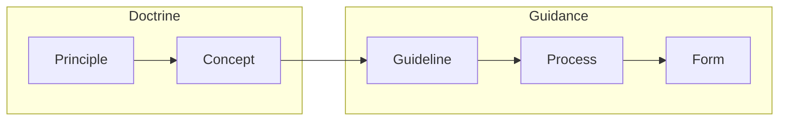

# How this doctrine is maintained

## Two review tiers

| Tier | Folders | To merge a change |
|---|---|---|
| Doctrine | Parts 1, 2, 3.1, 3.2, glossary, shared snippets | Approval from a doctrine owner (sector review group) |
| Guidance | 3.3–3.6, forms | One approval from any reviewer |

Doctrine changes slowly and needs agreement; guidance and forms change often and need light review. The split is set in `.github/CODEOWNERS`.

## Items and derivation

Principles, concepts, guidelines, processes and forms are **items**. Each item page starts with a short block of metadata:

```yaml
---
id: GDL-05
type: guideline
title: Extended search planning phase
derives_from:      # parent ID: parent version this was written against
  CON-16: 1
  CON-17: 1
owner: doctrine-group
last_reviewed: 2026-10-01
---
```

Allowed links run down the hierarchy: principle → concept → guideline → process → form. A guideline can't derive straight from a principle.



When an item's meaning changes, its author bumps `version`. Every child written against the old version is then listed as **stale** on the {doc}`status/traceability` page until someone checks it and updates its `derives_from` number. The tooling confirms that someone *looked*; it can't judge whether the child is still right.

## Checks on every change

| Check | Result |
|---|---|
| Parent ID doesn't exist, or wrong parent type | Fails |
| Child claims a newer parent version than exists | Fails |
| Item needs children and has none | Warning |
| Child written against an older parent version | Listed as stale |
| Parent text changed but version not bumped | Warning |
| `last_reviewed` older than the review interval | Listed as overdue |

Each pull request also gets a **Traceability** comment listing the findings it adds or resolves, and each release's changelog records the totals at release.

## Say it once

- Repeated text, such as the {term}`POD` scale, lives in one snippet file and is included on every page that needs it (five pages here).
- Acronyms are defined once in the {doc}`glossary`.
- The organisation name comes from one setting, so it reads "{{ org }}" everywhere.

## What the demo content shows

Text is condensed from draft v0.1, numbered as in the draft. Author notes, names and statistics still being verified are left out. Three states are deliberate, so the {doc}`status/traceability` page has something to show:

| State | Item | Why |
|---|---|---|
| Stale | {doc}`part-3/3-1-concepts/con-02-safety` | Written against PRN-13 v1; PRN-13 is now v2 |
| Coverage gap | {doc}`part-2/prn-15-iwi` | No concept derives from it yet |
| Overdue review | {doc}`part-3/3-3-guidelines/gdl-04-rescue` | Last reviewed more than a year ago |

## Releases

Each release has a version number like `v1.2.0`: edition, amendment and correction. A new edition means doctrine in Parts 1, 2 or 3.1–3.2 changed meaning; an amendment means guidance, processes or forms changed; a correction changes wording only. Release candidates such as `v2.0.0-rc.1` go out for consultation before the final version. Each release publishes the site and a PDF, and the {doc}`changelog` lists what changed and who contributed. Operational reviews cite the version number shown at the top of every page.
